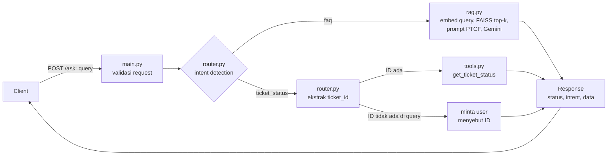

# IT Helpdesk Assistant

Backend API yang menjawab pertanyaan karyawan lewat dua jalur dalam satu endpoint: **RAG** untuk pertanyaan kebijakan/informasi, dan **tool call** untuk cek status tiket. Dibangun dengan FastAPI, FAISS, dan Gemini API, lalu dikemas dalam Docker.

## 1. Problem Statement

### Objective

Tim People & IT Operations menerima ratusan pertanyaan repetitif setiap hari. Sebagian adalah pertanyaan kebijakan umum, sebagian lagi permintaan yang butuh pengecekan data langsung. Objective project ini: **satu asisten AI internal yang menangani keduanya secara otomatis**, sehingga tim tidak perlu menjawab manual pertanyaan yang jawabannya sudah ada di knowledge base atau di data tiket.

### Dua jenis permintaan user

|     | Jenis                                  | Cara menjawab                                                                              | Contoh query                                                                     |
| --- | -------------------------------------- | ------------------------------------------------------------------------------------------ | -------------------------------------------------------------------------------- |
| 1   | **Informasi / kebijakan** (`faq`)      | RAG: cari di knowledge base (31 FAQ, 6 kategori), jawaban disusun LLM dari hasil pencarian | "Berapa jatah cuti tahunan saya?"<br>"Bagaimana cara reset password VPN?"        |
| 2   | **Cek status tiket** (`ticket_status`) | Tool call: ambil baris tiket dari data berdasarkan `ticket_id`, bukan pencarian semantik   | "Apa status tiket TICKET-0005 saya?"<br>"Cek TICKET-0042" (ID tidak ada di data) |

Kenapa tiket tidak lewat RAG: status tiket adalah data spesifik dan berubah-ubah. Pencarian semantik hanya mencari teks yang _mirip_, sehingga bisa mengembalikan tiket yang salah. Pencarian by ID selalu tepat atau tidak ketemu sama sekali.

### Batasan dan asumsi

- Knowledge base statis: `data/it_helpdesk_knowledge_base.csv` (31 FAQ, Bahasa Indonesia). Pertanyaan di luar isinya harus dijawab "tidak tahu", bukan dikarang.
- Data tiket adalah mock: `data/mock_tickets.csv` (15 tiket, `TICKET-0001` sampai `TICKET-0015`), hanya dibaca. Sistem tidak membuat atau mengubah tiket.
- Format ID tiket `TICKET-XXXX`. User diasumsikan menulis ID lengkap.
- Tidak ada autentikasi. Siapa pun yang menyebut ID bisa melihat status tiketnya. Karena itu response hanya menampilkan subject, status, dan tanggal update (nama karyawan sengaja tidak ditampilkan). Ini wajar untuk prototype dengan data mock, tetapi **tidak boleh dibawa ke produksi tanpa otorisasi**.
- Satu request = satu pertanyaan. Tidak ada riwayat percakapan.
- Dijalankan lokal dan di container Docker. Tidak di-deploy ke cloud.

## 2. Desain Workflow



Tahapan:

1. **API layer** (`main.py`): `POST /ask` menerima `{"query": "..."}`, memvalidasi, dan meneruskan ke router.
2. **Intent detection** (`router.py`): menentukan `faq` atau `ticket_status`.
3. **RAG path** (`rag.py`): query di-embed, FAISS mengambil top-3 FAQ paling mirip, hasilnya disisipkan sebagai konteks ke prompt (Persona/Task/Context/Format), Gemini menyusun jawaban. Jika skor kemiripan terbaik di bawah ambang (0,65), sistem langsung menjawab "tidak tahu" tanpa memanggil LLM.
4. **Tool path** (`router.py` + `tools.py`): `ticket_id` diekstrak dari query, lalu dicari di data tiket. Jika tidak ketemu, kembalikan pesan "tiket tidak ditemukan" tanpa crash.
5. **Response** selalu berbentuk `{ "status", "intent", "data" }`, termasuk saat error.

### Kriteria intent

Pendekatan: **baseline berbasis aturan (regex + keyword)**, tanpa LLM, supaya hasilnya deterministik, gratis, dan bisa dijelaskan.

| Intent          | Dipilih jika                                                                                                                                                                                         | Default? |
| --------------- | ---------------------------------------------------------------------------------------------------------------------------------------------------------------------------------------------------- | -------- |
| `ticket_status` | Query memuat pola ID `TICKET-<angka>` (tanpa membedakan huruf besar/kecil), **atau** memuat kata "tiket"/"ticket" bersama kata aksi cek (`status`, `cek`, `progress`, `perkembangan`, `sampai mana`) | Tidak    |
| `faq`           | Selain kondisi di atas                                                                                                                                                                               | **Ya**   |

Keputusan desain:

- **Default ke `faq`.** Query ambigu atau di luar cakupan masuk RAG. Di sana gagal dengan aman: jika hasil pencarian tidak relevan, sistem menjawab bahwa informasinya tidak ada.
- **Kata "tiket" saja tidak cukup.** Empat FAQ di knowledge base menyebut "tiket IT" sebagai prosedur, jadi "Bagaimana cara mengajukan laptop baru lewat tiket IT?" harus tetap `faq`.
- **Intent `ticket_status` tanpa ID** ("cek status tiket saya"): router tidak menebak. Responsnya meminta user menyebut ID tiket (`TICKET-XXXX`).
- Intent `unknown` hanya muncul jika router mengembalikan nilai di luar dua intent di atas (kondisi tak terduga).

## 3. Menjalankan Aplikasi

### Prasyarat: API key

Buat API key Gemini di <https://aistudio.google.com/apikey>, lalu:

```bash
cp .env.example .env        # lalu isi GEMINI_API_KEY di dalam .env
```

Tulis nilainya **tanpa tanda kutip** (`GEMINI_API_KEY=abc123`). File `.env` ada di `.gitignore` dan `.dockerignore`, jadi tidak ikut ter-commit maupun masuk ke image.

### Lokal (tanpa Docker)

Diuji dengan Python 3.12.

```bash
python3 -m venv .venv && source .venv/bin/activate
pip install -r requirements.txt
uvicorn app.main:app
```

Jalankan dari root repo (path data bersifat relatif). Sengaja **tanpa `--reload`**: setiap restart membangun ulang index (31 request embedding) dan bisa menghabiskan kuota API.

### Docker

```bash
docker build -t it-helpdesk-assistant .
docker run -p 8000:8000 --env-file .env it-helpdesk-assistant
```

API key dikirim saat `docker run` lewat environment variable; tidak pernah tersimpan di dalam image. Jika lupa `--env-file`, container berhenti dengan pesan `No API key was provided`.

Setelah jalan, buka <http://localhost:8000/docs> untuk Swagger UI, atau cek `GET /health`.

## 4. API

`POST /ask` dengan body `{"query": "..."}` (1-500 karakter).

```bash
curl -X POST http://localhost:8000/ask -H "Content-Type: application/json" \
  -d '{"query": "Apa status tiket TICKET-0005 saya?"}'
```

```json
{
  "status": "success",
  "intent": "ticket_status",
  "data": "Tiket TICKET-0005: Reset password VPN gagal terus. Status: Diproses. Update terakhir: 2026-08-27."
}
```

| Kondisi                                                                                               | HTTP | `status`  | Catatan                                         |
| ----------------------------------------------------------------------------------------------------- | ---- | --------- | ----------------------------------------------- |
| Berhasil dijawab (termasuk "tiket tidak ditemukan")                                                   | 200  | `success` |                                                 |
| Tanya status tiket tanpa menyebut ID                                                                  | 200  | `error`   | `data` berisi permintaan untuk menyebut ID      |
| Input tidak valid (kosong, hanya spasi, tanpa field `query`, bukan string, >500 karakter, JSON rusak) | 422  | `error`   | `intent: unknown`                               |
| Gemini gagal (kuota habis, server sibuk, key salah, respons kosong)                                   | 503  | `error`   | `intent: faq`; pesan aman tanpa detail internal |
| Kesalahan tak terduga                                                                                 | 500  | `error`   | Detail hanya di log server                      |

Jalur tiket tidak memakai LLM, sehingga tetap berfungsi (200) walaupun Gemini sedang gagal.

## 5. Hasil Pengujian

Diuji lewat HTTP ke server `uvicorn` lokal dan ke container Docker, dengan Gemini API sungguhan.

### 5 skenario wajib

| #   | Query                                    | Seharusnya                          | Hasil                   | Respons (ringkas)                                                                                                      |
| --- | ---------------------------------------- | ----------------------------------- | ----------------------- | ---------------------------------------------------------------------------------------------------------------------- |
| 1   | "Berapa jatah cuti tahunan saya?"        | `faq` → RAG                         | ✅ `faq`, 200           | 12 hari cuti, bisa diambil setelah masa kerja minimal 3 bulan (cocok dengan FAQ #1)                                    |
| 2   | "Bagaimana cara reset password VPN?"     | `faq` → RAG                         | ✅ `faq`, 200           | Reset mandiri lewat portal self-service IT; hubungi IT Support jika akun terkunci (cocok dengan FAQ #8)                |
| 3   | "Apa status tiket TICKET-0005 saya?"     | `ticket_status` → tool              | ✅ `ticket_status`, 200 | `Tiket TICKET-0005: Reset password VPN gagal terus. Status: Diproses. Update terakhir: 2026-08-27.` (cocok dengan CSV) |
| 4   | "Cek status TICKET-0042" (ID tidak ada)  | `ticket_status` → tool, tidak crash | ✅ `ticket_status`, 200 | `Tiket TICKET-0042 tidak ditemukan. Pastikan ID tiket benar (format TICKET-XXXX).`                                     |
| 5   | "kapan THR dibayarkan" (di luar cakupan) | `faq` → RAG, menjawab tidak tahu    | ✅ `faq`, 200           | `Maaf, saya tidak menemukan informasi tersebut di knowledge base. Silakan hubungi tim IT atau HR.`                     |

**Observasi:** router mengarahkan kelima query ke komponen yang tepat. Skenario 5 menarik: skor kemiripan "THR" terhadap FAQ slip gaji (0,67) **lolos** ambang 0,65, jadi bukan ambang skor yang menolaknya, melainkan instruksi di prompt yang membuat LLM mengaku tidak tahu. Dua lapis pengaman ini saling melengkapi: ambang skor menolak query yang jauh (misalnya resep masakan, tanpa memanggil LLM), prompt menangani query yang mirip topik tapi tidak ada di knowledge base.

### Skenario tambahan

| #   | Query                                | Hasil                              | Observasi                                                                                                                                                                                                                              |
| --- | ------------------------------------ | ---------------------------------- | -------------------------------------------------------------------------------------------------------------------------------------------------------------------------------------------------------------------------------------- |
| 6   | "Cek status tiket saya" (tanpa ID)   | `ticket_status`, `status: error`   | Meminta user menyebut ID, tidak menebak                                                                                                                                                                                                |
| 7   | "resep nasi goreng enak"             | `faq`, "tidak menemukan informasi" | Ditolak ambang skor dalam 0,6 detik, tanpa memanggil LLM                                                                                                                                                                               |
| 8   | "Bagaimana cara membuat tiket baru?" | `faq`, "tidak menemukan informasi" | **Routing benar** (bukan cek status), tetapi saya awalnya mengharapkan jawaban. Knowledge base memang tidak memuat prosedur membuat tiket (hanya menyebut tiket sebagai jalur pengajuan), jadi "tidak tahu" adalah perilaku yang tepat |
| 9   | `""` (kosong)                        | HTTP 422 `status: error`           | Divalidasi sebelum menyentuh router                                                                                                                                                                                                    |

## 6. Keterbatasan

1. **Router berbasis aturan.** (a) Pertanyaan how-to seperti "Bagaimana cara cek status tiket?" terbaca `ticket_status`, padahal lebih tepat `faq`. (b) Jika query memuat beberapa ID tiket, hanya yang pertama diproses. (c) Query campuran (misalnya cuti + cek tiket) dimenangkan `ticket_status`. (d) Kosakata di luar daftar kata aksi (misalnya "tiket saya udah beres belum?") tidak terdeteksi sebagai `ticket_status`. Pendekatan berbasis LLM bisa mengatasi sebagian, dengan konsekuensi biaya dan latensi.
2. **Kuota API free tier sangat ketat.** Model `gemini-3.6-flash` ternyata hanya 20 request/hari di free tier dan habis saat pengembangan, sehingga kode memakai `gemini-3.5-flash-lite`. Kuota harian model ini belum diketahui. Embedding dibatasi 100 request/menit (membangun index = 31 request). Jika kuota habis, FAQ mengembalikan 503, sedangkan cek tiket tetap jalan. Retry otomatis (3x) membantu untuk gangguan sesaat, bukan untuk kuota harian.
3. **Index di memori dan dibangun saat request FAQ pertama.** Request itu lebih lambat, dan index hilang saat proses restart (dibangun ulang, memakai 31 request embedding lagi). Untuk KB sebesar ini tidak masalah; untuk KB besar index perlu disimpan ke disk.
4. **Ambang skor 0,65 adalah heuristik** dari 13 query sampel, bukan hasil evaluasi menyeluruh. Query sah dengan kata-kata tidak lazim bisa ikut tertolak.
5. **Latensi FAQ bervariasi** (sekitar 1,5 sampai 11 detik pada pengujian), sebagian besar waktu tunggu Gemini API. Cek tiket instan.
6. **Tidak ada autentikasi dan tidak ada memori percakapan** (lihat batasan di atas).
7. **Pengujian manual.** Skenario dijalankan lewat script sekali pakai dan hasilnya dicatat di sini; repo ini belum memiliki test suite otomatis.
8. **Hanya diuji dengan query Bahasa Indonesia.** Query berbahasa lain belum diuji.
