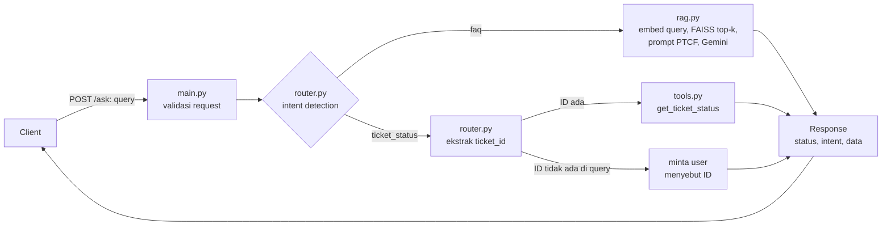

# IT Helpdesk Assistant

Backend API yang menjawab pertanyaan karyawan lewat dua jalur dalam satu endpoint: **RAG** untuk pertanyaan kebijakan/informasi, dan **tool call** untuk cek status tiket. Dibangun dengan FastAPI, FAISS, dan Gemini API, lalu dikemas dalam Docker.

## 1. Problem Statement

### Objective
Tim People & IT Operations menerima ratusan pertanyaan repetitif setiap hari. Sebagian adalah pertanyaan kebijakan umum, sebagian lagi permintaan yang butuh pengecekan data langsung. Objective project ini: **satu asisten AI internal yang menangani keduanya secara otomatis**, sehingga tim tidak perlu menjawab manual pertanyaan yang jawabannya sudah ada di knowledge base atau di data tiket.

### Dua jenis permintaan user

| | Jenis | Cara menjawab | Contoh query |
|---|---|---|---|
| 1 | **Informasi / kebijakan** (`faq`) | RAG: cari di knowledge base (31 FAQ, 6 kategori), jawaban disusun LLM dari hasil pencarian | "Berapa jatah cuti tahunan saya?"<br>"Bagaimana cara reset password VPN?" |
| 2 | **Cek status tiket** (`ticket_status`) | Tool call: ambil baris tiket dari data berdasarkan `ticket_id`, bukan pencarian semantik | "Apa status tiket TICKET-0005 saya?"<br>"Cek TICKET-0042" (ID tidak ada di data) |

Kenapa tiket tidak lewat RAG: status tiket adalah data spesifik dan berubah-ubah. Pencarian semantik hanya mencari teks yang *mirip*, sehingga bisa mengembalikan tiket yang salah. Pencarian by ID selalu tepat atau tidak ketemu sama sekali.

### Batasan dan asumsi
- Knowledge base statis: `data/it_helpdesk_knowledge_base.csv` (31 FAQ, Bahasa Indonesia). Pertanyaan di luar isinya harus dijawab "tidak tahu", bukan dikarang.
- Data tiket adalah mock: `data/mock_tickets.csv` (15 tiket, `TICKET-0001` sampai `TICKET-0015`), hanya dibaca. Sistem tidak membuat atau mengubah tiket.
- Format ID tiket `TICKET-XXXX`. User diasumsikan menulis ID lengkap.
- Tidak ada autentikasi. Siapa pun yang menyebut ID bisa melihat status tiketnya. Ini wajar untuk prototype dengan data mock, tetapi **tidak boleh dibawa ke produksi tanpa otorisasi**.
- Satu request = satu pertanyaan. Tidak ada riwayat percakapan.
- Dijalankan lokal dan di container Docker. Tidak di-deploy ke cloud.

## 2. Desain Workflow



Tahapan:
1. **API layer** (`main.py`): `POST /ask` menerima `{"query": "..."}`, memvalidasi, dan meneruskan ke router.
2. **Intent detection** (`router.py`): menentukan `faq` atau `ticket_status`.
3. **RAG path** (`rag.py`): query di-embed, FAISS mengambil top-k FAQ paling mirip, hasilnya disisipkan sebagai konteks ke prompt (Persona/Task/Context/Format), Gemini menyusun jawaban.
4. **Tool path** (`router.py` + `tools.py`): `ticket_id` diekstrak dari query, lalu dicari di data tiket. Jika tidak ketemu, kembalikan pesan "tiket tidak ditemukan" tanpa crash.
5. **Response** selalu berbentuk `{ "status", "intent", "data" }`, termasuk saat error.

### Kriteria intent

Pendekatan: **baseline berbasis aturan (regex + keyword)**, tanpa LLM, supaya hasilnya deterministik dan bisa dijelaskan. LLM hanya dipertimbangkan jika pengujian menunjukkan baseline kurang akurat.

| Intent | Dipilih jika | Default? |
|---|---|---|
| `ticket_status` | Query memuat pola ID `TICKET-<angka>` (tanpa membedakan huruf besar/kecil), **atau** memuat kata "tiket"/"ticket" bersama kata aksi cek (`status`, `cek`, `progress`, `sudah sampai mana`) | Tidak |
| `faq` | Selain kondisi di atas | **Ya** |

Keputusan desain:
- **Default ke `faq`.** Query ambigu atau di luar cakupan masuk RAG. Di sana gagal dengan aman: jika hasil pencarian tidak relevan, LLM diinstruksikan menjawab bahwa informasinya tidak ada.
- **Kata "tiket" saja tidak cukup.** "Bagaimana cara membuat tiket baru?" adalah pertanyaan informasi (`faq`), bukan cek status. Karena itu `ticket_status` butuh ID atau kombinasi "tiket" + kata aksi cek.
- **Intent `ticket_status` tanpa ID** ("cek status tiket saya"): router tidak menebak. Responsnya meminta user menyebut ID tiket (`TICKET-XXXX`).
- Intent `unknown` hanya muncul jika router mengembalikan nilai di luar dua intent di atas (kondisi tak terduga), dan ditangani sebagai error terstruktur di `/ask`.

## Menjalankan Secara Lokal (tanpa Docker)

```bash
python3 -m venv .venv && source .venv/bin/activate
pip install -r requirements.txt
cp .env.example .env   # lalu isi GEMINI_API_KEY di dalam .env
uvicorn app.main:app --reload
```

## Menjalankan dengan Docker

```bash
docker build -t it-helpdesk-assistant .
docker run -p 8000:8000 --env-file .env it-helpdesk-assistant
```

## Menguji Endpoint

```bash
curl -X POST http://localhost:8000/ask \
  -H "Content-Type: application/json" \
  -d '{"query": "berapa jatah cuti tahunan saya?"}'
```

_Bagian hasil pengujian 5 skenario dan keterbatasan ditambahkan setelah implementasi dan testing selesai._
